 

## 👨‍💻 About Me | 关于我

**Chang Ma — Sophomore in Artificial Intelligence at Anhui Normal University.**

I use this space as both a structured learning archive and a portfolio of personal and team projects. My current work revolves around two core tracks: strengthening CS fundamentals (C, C++, Data Structures, Computer Organization) and exploring how AI Agents and AI-assisted workflows accelerate real-world software creation. Guided by **Research, Practice, and Create**, I document my code, experiments, and product iterations here.

我是马畅。这里既是我的计算机科学学习档案，也用来展示个人项目和团队实践。现阶段的日常由两部分构成：一是通过 C/C++ 编程训练、算法竞赛与系统课程夯实计算机基础；二是深入研究 AI Agent 产品与智能辅助编程，探索软件开发方式的演进。从理解原理（Research）、动手验证（Practice）到做出真正可用的作品（Create），我希望用真实的代码提交与项目迭代，记录从理论走向创造的每一步。

## 🚀 Featured Projects | 精选项目

### 🌱 [Codefarm](https://github.com/chang814/codefarm) · 用 C++ 种田的编程游戏

A Chinese 3D programming farm game. You write real C++ (`#include`, `int main()`) to teach a little farm bot to harvest, plant and automate a whole field, unlocking one programming idea at a time across a 39-node skill tree. The rules run in a pure C++ simulator with its own interpreter; Godot renders the farm. Inspired by *The Farmer Was Replaced* by Timon Herzog.

中文 3D 编程农场游戏：用标准 C++ 程序指挥小 bot 收割、种植，把一块草地变成自动化农场。39 个技能“先痛后药”逐步解锁循环、条件、函数、数组和多无人机。规则由自写的 C++ 模拟器与解释器驱动，Godot 负责画面；灵感来自 Timon Herzog 的《The Farmer Was Replaced》。

<table>
<tr>
<td width="50%" valign="top">

### ⚫ [五子棋对战游戏 · Gobang](https://github.com/chang814/project/tree/main/gobang)

A team assignment for our Programming Training course: local two-player, six levels of AI, and LAN matches. I worked on the game rules, save system and AI engine (minimax, alpha-beta, iterative deepening), and contributed to LAN play.

《程序设计训练》课程团队作业，支持本地双人、六档人机和局域网对战。我主要负责棋局逻辑、存档和 AI 引擎，并参与了联网模块。

</td>
<td width="50%" valign="top">

### 📝 [畅记 · Changji](https://github.com/chang814/project/tree/main/changji)

A personal English practice tool for word typing, listening and spelling, and sentence practice, available as a web app and a Windows desktop app.

我做的英语练习工具，支持单词跟练、听音拼写和长句输入，有网页版和 Windows 桌面版。

</td>
</tr>
</table>

## 🛠️ Tech Stack & Tools | 技术栈与工具

<table>
<tr>
<td><b>💻 Languages</b> 编程语言</td>
<td>

</td>
</tr>
<tr>
<td><b>🎮 Engines & Frameworks</b> 引擎与框架</td>
<td>

</td>
</tr>
<tr>
<td><b>⚙️ Dev Tools</b> 开发工具</td>
<td>

</td>
</tr>
<tr>
<td><b>🤖 AI Tools & Agents</b> AI 工具与智能体</td>
<td>

</td>
</tr>
</table>

Exploring AI-powered development tools, agentic workflows, and human-AI collaboration.
探索 AI 辅助开发工具、智能体工作流与人机协作的新模式。

## 📚 Currently Learning & Exploring | 正在学习与探索

<table>
<tr>
<td width="50%" valign="top">

### 🧱 Core CS Foundations
#### 计算机科学基础

- **Algorithms & Data Structures** — intensive problem-solving and competitive programming in C++. 以 C++ 为主语言，持续进行算法思维与竞赛训练。
- **Object-Oriented Programming** — foundational software and desktop GUI apps in Java. 基于 Java 进行面向对象编程实践与 GUI 界面开发。
- **Computer Systems** — Computer Organization and the hardware-software interface. 学习计算机组成原理，理解代码在硬件层面的运行逻辑。

</td>
<td width="50%" valign="top">

### 🤖 AI Agents & Workflows
#### 智能体与开发范式

- **🔍 Research** — analyzing the capabilities and mechanisms of emerging AI Agents. 持续体验与剖析不同 AI Agent 产品的能力边界与工作机制。
- **🛠 Practice** — integrating AI coding tools into everyday development. 在日常编程中实践人机协作，探索 AI 辅助开发对工程流程的改变。
- **🚀 Create** — turning personal ideas into working software, like [Codefarm](https://github.com/chang814/codefarm). 借助新一代智能工具，把个人想法变成真正可用的独立项目。

</td>
</tr>
</table>

## 📂 Repository Index | 仓库索引

| Repository | 内容 |
| --- | --- |
| 🌱 **[codefarm](https://github.com/chang814/codefarm)** | C++ 编程农场游戏：模拟器、解释器、Godot 工程与完整测试 |
| 🗂 **[project](https://github.com/chang814/project)** | 公开作品集：五子棋与畅记的源码和项目说明 |
| 🔒 Private study archives | 私有学习档案：C/C++ 算法练习与 Java 面向对象实验 |

## ✨ My Philosophy | 个人信念

> ### 长风破浪会有时，直挂云帆济沧海。

## 🔗 Connect With Me

Thanks for visiting my profile! · 感谢来访 🌾

